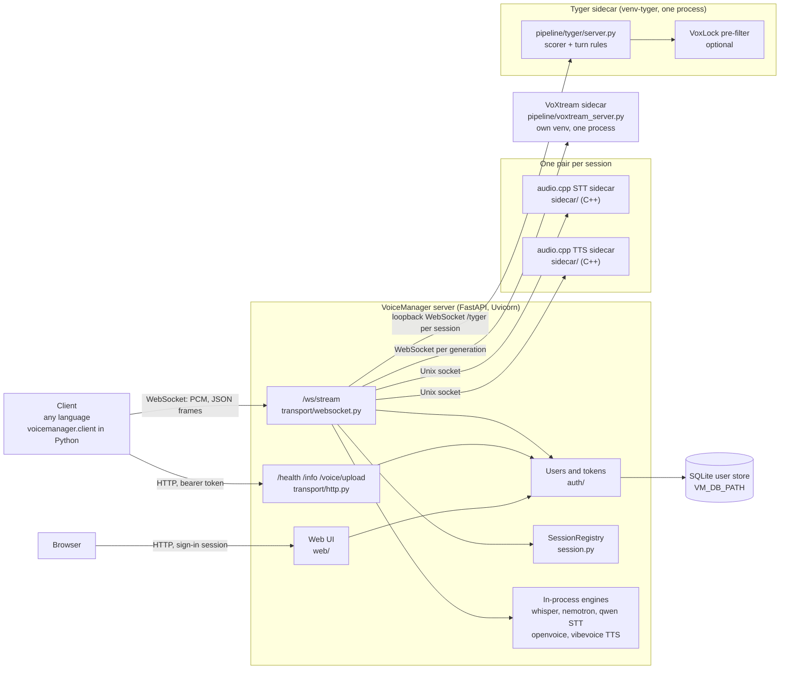
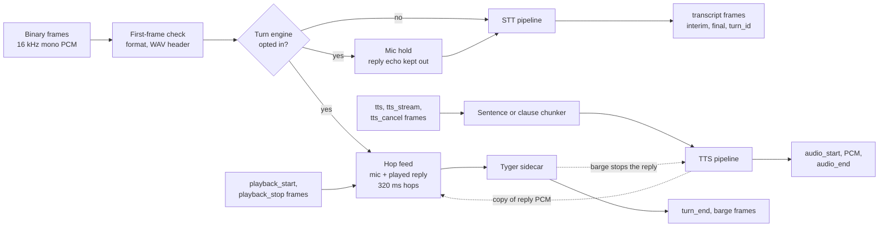
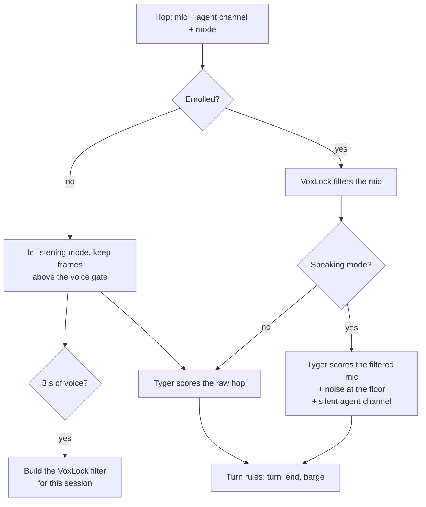

# Architecture

This page shows how VoiceManager is built: the processes, the path of one connection, and the turn engine. The WebSocket protocol that clients use is in [client-integration.md](client-integration.md).

## Processes

One FastAPI server (`python -m voicemanager` or `voicemanager serve`) holds the client connections. Engines that pin their own runtime run as sidecar processes that the server starts and stops.

- The server reads `.env` (`VM_` prefix) once at startup. `VM_STT_ENGINE` and `VM_TTS_ENGINE` choose one engine of each kind for every connection.
- The lifespan in `app.py` loads the models and starts the sidecars the settings need. If a model or a sidecar fails to load, the server does not start.
- The audio.cpp engines start one sidecar process per session, so an engine crash stops only that session.
- VoXtream and Tyger pin their own PyTorch, so each runs as one process from its own virtual environment, and all sessions share it.
- All session state is in memory. It is lost when the server restarts.

## One connection

Binary frames carry mic audio to STT. JSON text frames carry TTS requests. STT and TTS run at the same time on the socket.

- A connection opts in to the turn engine with a `turn_engine` frame before its first audio. Only the audiocpp STT engine supports it. Code: `transport/turn_engine.py`.
- The client reports when each reply starts and stops playing. The hop feed uses these edges to put the reply's audio next to the mic audio it overlaps.
- A new TTS request cancels the request in flight. A barge from Tyger ends the reply on the server, with `audio_end` reason `interrupted`.

## Turn engine and the pre-filter

The Tyger sidecar scores each hop and applies the turn rules (`pipeline/tyger/rules.py`). A hop that overlaps a playing reply is in speaking mode. Any other hop is in listening mode.

With `VM_TYGER_PREFILTER=voxlock`, each session's scorer is wrapped in the pre-filter (`pipeline/tyger/prefilter.py`). It is experimental and off by default.

- The filter learns the user's voice from the first 3 s of speech heard while no reply plays.
- The STT always gets the raw mic. The pre-filter changes only what Tyger hears.
- VoxLock runs on the sidecar's GPU only. The sidecar exits at startup if it cannot run there.

## Source layout

| Path | Contents |
|---|---|
| `src/voicemanager/app.py` | App factory and lifespan: loads models, starts sidecars, wires `app.state` |
| `src/voicemanager/config.py` | `Settings`, read from `.env` |
| `src/voicemanager/protocol.py` | Pydantic WebSocket frames and the audio format |
| `src/voicemanager/session.py` | `SessionRegistry` of active sessions |
| `src/voicemanager/transport/` | HTTP and WebSocket handlers, turn ids, the turn engine link |
| `src/voicemanager/pipeline/` | STT and TTS pipelines per engine, the chunkers, the VoXtream sidecar |
| `src/voicemanager/pipeline/tyger/` | Tyger sidecar server, scorer, turn rules, pre-filter, vendored VoxLock |
| `src/voicemanager/models/` | Model loading and device selection |
| `src/voicemanager/auth/` | User store and bearer tokens |
| `src/voicemanager/web/` | Web UI for accounts and tokens |
| `src/voicemanager/client.py` | Python client library |
| `sidecar/` | audio.cpp sidecar (C++) and its protocol, `sidecar/PROTOCOL.md` |
